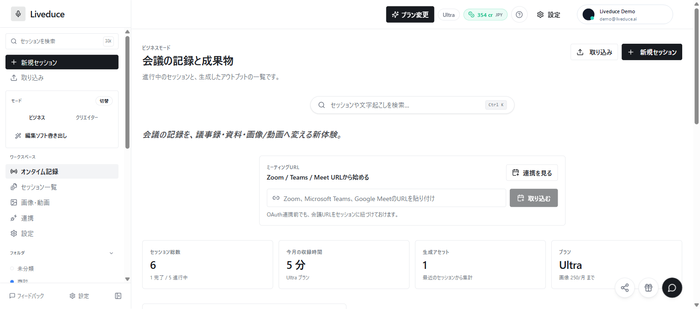
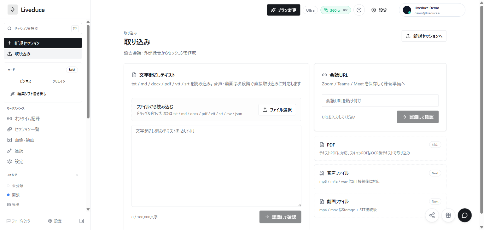

# Liveduce-App — 議事録アプリの開発ポートフォリオ

Liveduceの画面設計と操作フローを紹介する、固定データのインタラクティブデモです。会議の記録から、議事録・決定事項・画像や動画のコンセプト・共有文案などの成果物へつなぐ体験を提示します。

このリポジトリは実績紹介用のデモです。商用サービス本体の全ソース、実際の録音・文字起こし・AI生成基盤は含みません。画面素材は2026年8月時点のスナップショットであり、最新の本番稼働状況を示すものではありません。

[Webデモを見る](https://liveduce-portfolio-demo.vercel.app/) · [操作デモを開く](https://liveduce-portfolio-demo.vercel.app/demo)

2026年10月22日に、Next.js 16.4.2への更新と、このリポジトリの説明・書き出し表示の修正をWebデモへ反映しました。画面素材は引き続き2026年8月時点のものです。公開ページと配信ソースの一致を確認しています。

## 見どころ

- `/`：プロダクト概要、体験設計、画面素材をまとめたポートフォリオ。
- `/demo`：ダッシュボード、新規セッション、取り込み、セッション、成果物、外部連携、料金画面を操作するデモ。
- 発言選択から成果物へ進む導線、プラン比較、書き出しなどの画面と操作。
- 架空の会議データを使い、顧客の議事録や本番の認証情報を必要とせず確認できる構成。

## スクリーンショット

リポジトリ内の画面素材です。生成結果や会議内容はデモ用の固定表示です。





## 技術スタック

`package.json`に記載されたバージョンです。

| 項目 | 使用技術 |
| --- | --- |
| フレームワーク | Next.js 16.4.2 / App Router |
| UI | React / React DOM 19.2.8、CSS |
| 言語 | TypeScript 7.0.2 |
| 任意のテスト決済 | Stripe SDK 22.5.0 |
| パッケージ管理 | pnpm 10.15.1 |

## 構成

```text
app/
  page.tsx                 # ポートフォリオ (/)
  demo/page.tsx            # 操作デモ (/demo)
  api/stripe/              # 任意のStripeテスト決済
  globals.css              # 共通スタイル
components/                # 各画面・UI・デモの状態管理
lib/demo-data.ts           # 固定のデモデータ
lib/demo-stripe.ts         # テスト鍵の検査など
public/portfolio/          # 画面素材
public/brand/              # ブランド画像
```

## ローカルで確認する

Next.jsの実行要件を満たすNode.jsとpnpm 10.15.1を用意し、リポジトリのルートで実行します。通常の画面確認にはAPIキーや環境変数は不要です。

```sh
pnpm install
pnpm typecheck
pnpm build
pnpm dev
```

開発サーバー起動後、`http://localhost:3000` と `http://localhost:3000/demo` を開きます。本番ビルドをローカルで確認する場合は、`pnpm build` の後に `pnpm start` を実行します。

### 任意：Stripeのテスト決済

公開デモでは未設定のまま使うことを推奨します。テスト決済の動作確認をする場合だけ、`.env.example` を参考に `.env.local` に `STRIPE_SECRET_KEY` を設定します。コードは `sk_test_` で始まる鍵のみ受け付けます。実際の鍵をREADME、スクリーンショット、コミットへ含めないでください。決済時はStripeの外部テスト環境へ通信します。

## デモの範囲と制約

- 録音ボタンは固定の発言を順次表示するシミュレーションです。マイクからの録音は行いません。
- 会議URL・音声・動画・テキスト取り込み、AI生成結果、外部サービス連携は、固定データと画面上の操作を見せるデモです。
- OpenAI、Google、Gladia、Supabase、本番の認証・議事録DBには接続しません。
- 操作状態はブラウザ内のメモリで保持します。商用のデータ保存・認証・権限管理は含みません。
- ダウンロードできるのは固定の議事録のMarkdownファイルです。TXT・SRT・VTT・PPTのファイル出力は実装していません。資料構成案は画面表示のみです。
- 料金やプラン表示はデモ用です。顧客数、売上、導入実績、商用運用の完成を示すものではありません。
- 検索エンジン向けに `noindex` を設定しています。これは閲覧制限や認証の代わりにはなりません。

## 制作・担当範囲の表記

この公開ソースで確認できる成果物は、画面構成、操作フロー、フロントエンドの実装、固定データ、画面素材です。AI支援を含む開発・制作物として紹介します。人間による企画・判断とAIとの協働を含み、全コードを単独・手作業で作成したという主張はしません。

個人ごとの詳細な担当割合や、商用サービス本体の開発範囲は、このリポジトリだけでは検証できません。応募書類などでは、実際に担当した企画・設計・実装・検証の範囲を別途明示してください。

## 公開・デモ運用方針

GitHubでは公開用に切り出したこのデモを提示し、サービス本体の秘密情報や実際の会議データを追加しない方針です。Webに配置する場合も固定データ版と分かる表示を保ち、Stripeの鍵は未設定を基本とします。

## ライセンス

現時点ではOSSライセンスを付与していません。公開は閲覧・実績紹介を目的としており、コードや画像の再利用・再配布を包括的に許諾するものではありません。第三者の依存パッケージには各パッケージのライセンスが適用されます。
